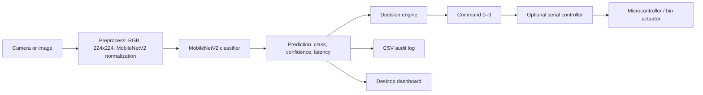

# AI-Driven Biomedical Waste Segregator

An end-to-end computer-vision application that classifies biomedical waste into Yellow, Red, Blue, and White disposal categories. It uses a transfer-learned MobileNetV2 model, supports image, folder, and webcam inference, and can send a validated bin command to a microcontroller over serial.

> Safety note: this project is a supervised classification aid. It does not replace clinical judgement, infection-control procedures, or local biomedical-waste regulations. Validate every model and hardware decision before live use.

## Features

- Test-set evaluation with accuracy, precision, recall, F1, specificity, top-k accuracy, curves, charts, and PDF output.
- Single-image, batch-folder, and real-time webcam inference.
- Isolated decision engine: `yellow → 0`, `red → 1`, `blue → 2`, `white → 3`.
- Optional serial communication with acknowledgement and automatic reconnection.
- CSV prediction audit trail and a Tkinter desktop dashboard.
- TensorFlow Lite export, performance benchmarking, automated tests, and final build verification.

## Architecture



## Project layout

```text
src/
  preprocessing/     Dataset and image transformations
  training/          Model architecture and training workflow
  evaluation/        Test metrics, charts, and PDF report generation
  inference/         Image, folder, and webcam prediction workflows
  decision/          Pure label-to-command mapping (no hardware I/O)
  communication/     Serial transport and acknowledgement handling
  dashboard/         Tkinter desktop interface
  optimization/      Benchmark and TensorFlow Lite export tooling
  verification/      Final non-destructive production checks
  utils/             Logging and prediction audit utilities
tests/               Automated unit tests
results/             Generated reports, metrics, charts, and test output
logs/                Runtime logs and prediction audit CSV
```

## Installation

Requires Python 3.11+ and a webcam only for real-time inference.

```powershell
python -m venv .venv
.\.venv\Scripts\Activate.ps1
pip install -r requirements.txt
```

Place the trained model at `models/biomedical_waste_mobilenetv2.keras` and retain `data/labels.json`.

## Usage

Evaluate the model:

```powershell
python -m src.evaluation.evaluate_model
```

Classify one image or a whole folder:

```powershell
python -m src.inference.predict_image path\to\image.jpg
python -m src.inference.predict_folder path\to\folder --recursive
```

Run the webcam (`Q` or `Esc` exits; `H` shows/hides history):

```powershell
python -m src.inference.webcam --camera 0
```

Launch the dashboard:

```powershell
python -m src.app
```

For hardware, enter the detected COM port in the dashboard and connect. The firmware must accept newline-delimited `0`, `1`, `2`, or `3` and reply with an acknowledgement such as `ACK:2`.

## Outputs

- `results/evaluation/`: metrics JSON, text report, confusion matrix, ROC/PR charts, and PDF report.
- `logs/prediction_logs.csv`: timestamp, prediction, confidence, latency, command, and status.
- `<input folder>/prediction_results.csv`: per-file batch results.
- `results/performance/benchmark.json`: latency, estimated FPS, CPU time, memory, and model size.
- `results/testing/test_report.json`: automated test summary.

## Testing and production checks

```powershell
python -m tests.run_tests
python -m src.verification.final_check
```

Optional deployment optimization:

```powershell
python -m src.optimization.optimize_model --benchmark-image path\to\image.jpg --runs 20
python -m src.optimization.optimize_model --export-tflite
```

## Model and dataset

The model is a four-class MobileNetV2 transfer-learning classifier using TensorFlow/Keras. Input images are RGB, resized to 224×224, then normalized with MobileNetV2 preprocessing. The expected class order is defined centrally in `data/labels.json`:

| Index | Category | Serial command |
| ---: | --- | ---: |
| 0 | Yellow Waste | 0 |
| 1 | Red Waste | 1 |
| 2 | Blue Waste | 2 |
| 3 | White Waste | 3 |

Dataset images and trained model binaries are intentionally ignored by Git because of size and provenance. Use the supplied directory structure and document the approved dataset source before publishing.

## Limitations and future scope

Performance depends on image quality, lighting, training distribution, and appropriate class labels. The current model does not detect multiple objects or localize waste within a scene. Future work can add object detection, confidence thresholds with manual-review routing, TFLite hardware testing, and authenticated cloud audit storage.

## Waste to bin mapping

| Model output | Bin |
| --- | ---: |
| Yellow (yellow) | 0 |
| Red (red) | 1 |
| Blue (blue) | 2 |
| White (white) | 3 |

Glass equipment packaging and metal equipment packaging route to blue bin 2. These are routing aliases; the model has four outputs and reports the actual predicted label (blue) with its confidence.

The dashboard camera is preview-only. A complete newline-delimited JSON request such as {"object_id":"unique-id","action":"classify"} triggers one inference on the latest frame and one JSON response line. Responses echo the object ID. Invalid requests or an unavailable frame receive a safe error response. Do not reuse object IDs; duplicates are ignored. The serial controller does not retry commands after an ambiguous write or ACK timeout.

See docs/WASTE_BIN_MAPPING.md for protocol details. No firmware is included, so physical board behavior has not been tested.