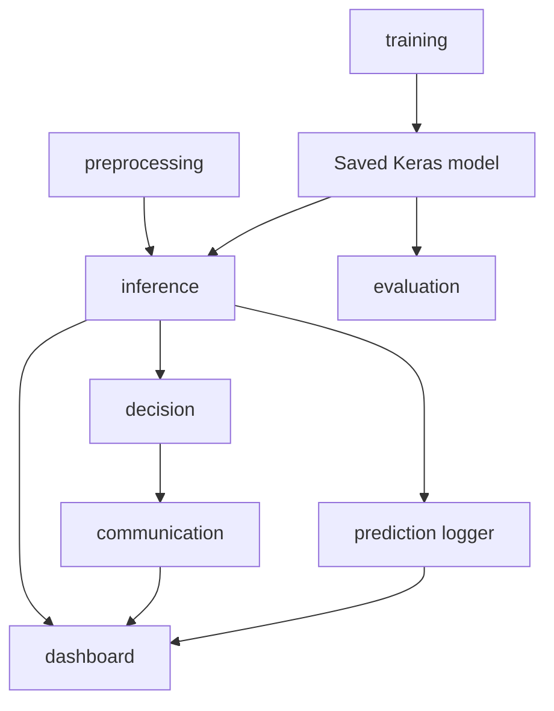

# Software architecture

The application follows a one-way dependency direction: preprocessing feeds inference; inference produces a prediction object; the decision engine converts that object to a command; the communication layer may transmit only that command. This prevents serial or actuator concerns from being embedded inside the AI model.

## Operational workflow

1. A user supplies an image or starts the webcam.
2. Inference validates RGB pixels, resizes to 224×224, normalizes, and produces class probabilities.
3. The dashboard displays the result and writes an audit row.
4. If—and only if—a serial connection has been explicitly opened, the dashboard maps the label to a command and asks the communication layer to send it.
5. The controller logs the acknowledgement or connection failure; the model itself never controls a device.
