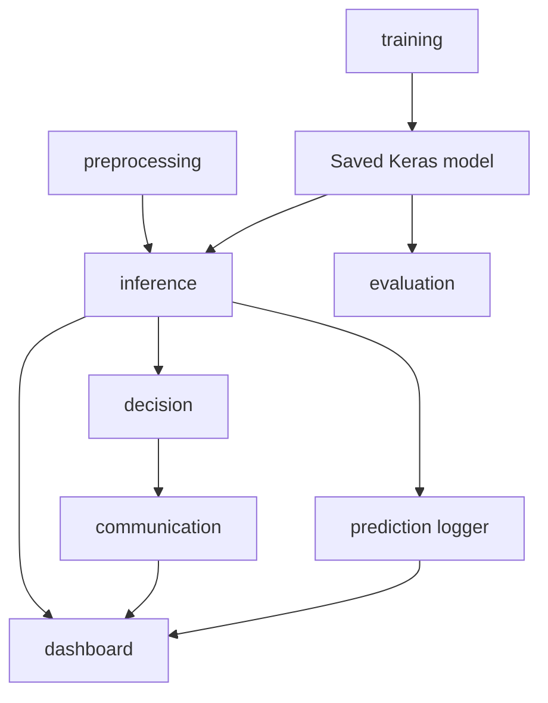

# Software architecture

The dashboard owns the serial connection. A background listener reads newline-delimited JSON requests and queues them for a background classification worker. That worker classifies the latest camera frame and sends one correlated response. The Tk event thread applies display updates from a queue.

## Operational workflow

1. A user supplies an image or starts the webcam.
2. Inference validates RGB pixels, resizes to 224×224, normalizes, and produces class probabilities.
3. The dashboard displays the result and writes an audit row.
4. When connected, a background serial listener continuously reads complete JSONL capture requests, independently of camera preview refreshes.
5. Each valid request triggers one background inference and one newline-terminated success or failure response carrying the supplied object_id.
